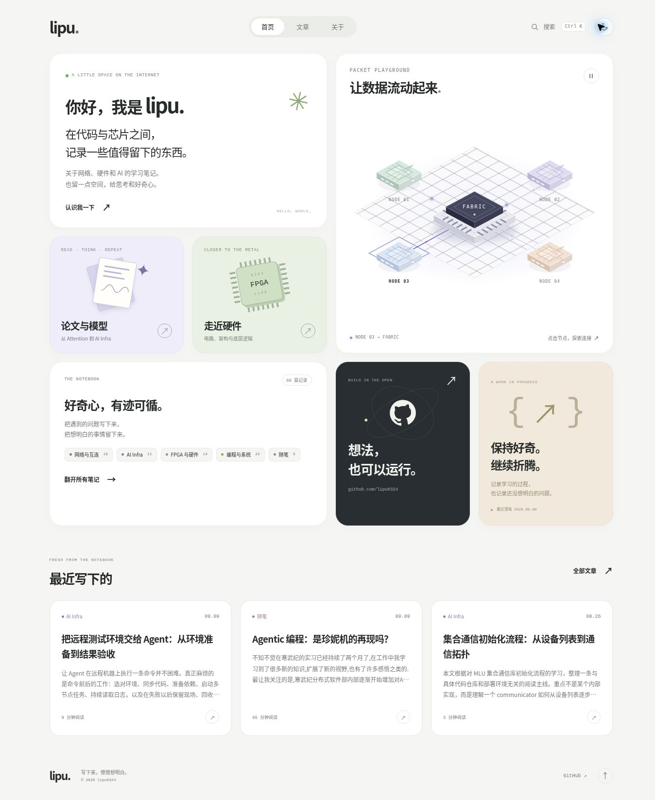
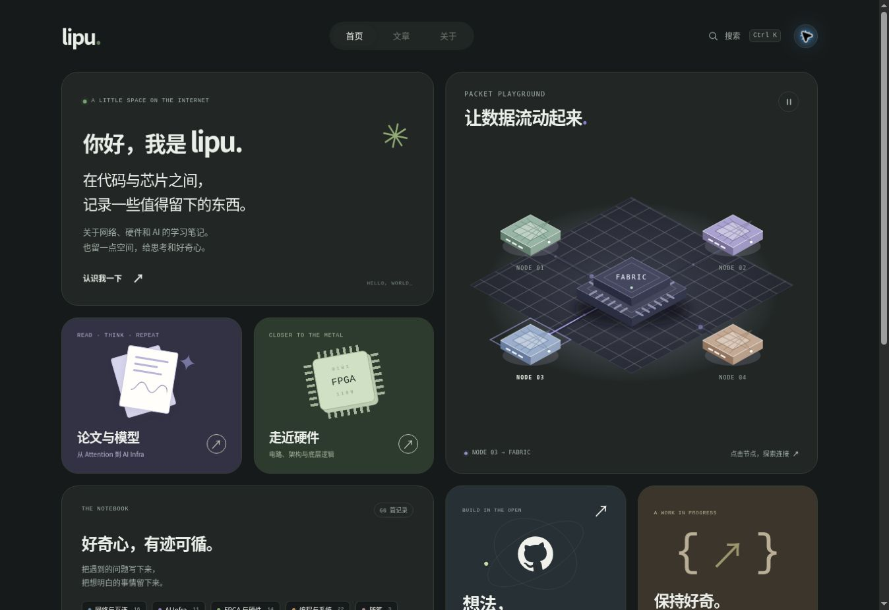
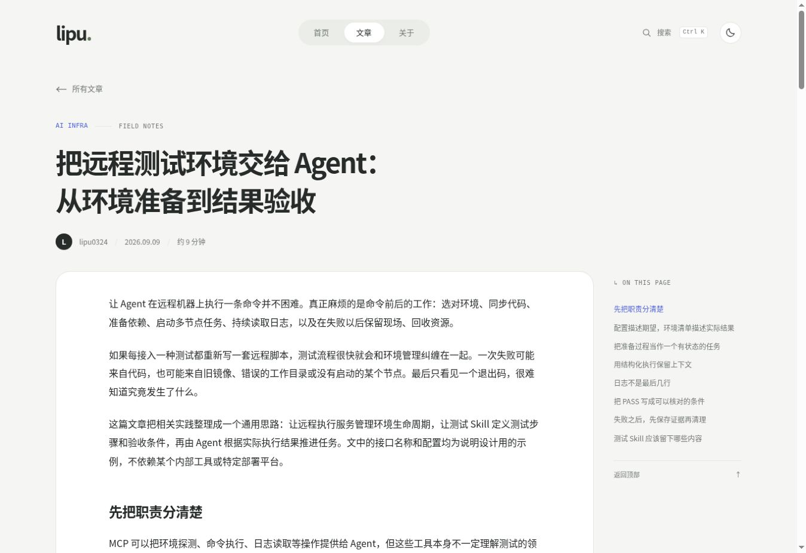
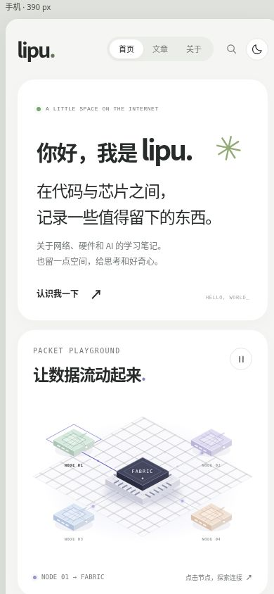

# Bento 博客设计预览

这一版为现有 Hexo 博客新增 `themes/bento` 主题，参考 [Nev Flynn 的 Bento 个人主页方向](https://recent.design/i/7awst0q-nev-flynn)，用浅色圆角卡片、柔和配色与可交互的网络图，呈现博客中已有的网络、硬件、AI 和编程笔记。

## 首页



## 深色模式



## 文章阅读



## 手机布局



## 这一版实现了什么

- 首页：个人简介、网络数据流交互、论文与模型入口、硬件入口、主题导航、GitHub、最近文章。
- 数据流主视觉：点击或键盘选择节点，切换高亮路径；可以暂停，遵循减少动态效果的系统偏好。它是视觉演示。
- 文章索引：接入现有文章，按日期排列；提供网络与互连、AI Infra、FPGA 与硬件、编程与系统、随笔五个展示分组。原始分类、标签和内容保持不变。
- 搜索：全站标题、标签、摘要搜索；文章列表支持跨分页筛选，也支持当前分类、标签、年月范围内的搜索。
- 正文：中文阅读排版、桌面目录、手机折叠目录、代码高亮与复制、图片放大、前后篇入口。
- 浅色/深色切换、键盘焦点样式和响应式布局。

## 本地查看

在仓库中切到预览分支，然后启动 Hexo：

```sh
git fetch origin design/bento-preview
git switch design/bento-preview
npm ci
npm run server
```

打开 Hexo 输出的本地地址。正式构建仍使用 `npm run build`。

## 修改入口

- 首页文案与卡片：`themes/bento/layout/index.ejs`
- 全站布局与导航：`themes/bento/layout/layout.ejs`
- 基础配色与首页样式：`themes/bento/source/css/style.css`
- 网络主视觉：`themes/bento/layout/_partial/fabric.ejs` 及对应 `fabric.css`、`fabric.js`
- 文章页：`themes/bento/layout/post.ejs`、`themes/bento/source/css/article.css`
- 展示分组和摘要：`themes/bento/scripts/helpers.js`

主题沿用现有 Hexo 依赖，不需要后端或新的在线服务。搜索索引在构建时生成。新的文章仍按原来的方式写入 `source/_posts`。

## 验证与发布状态

- Hexo 完整构建通过；当前接入 66 篇文章。
- 仓库原有 3 个测试通过。
- 浏览器验证首页、深浅色切换、节点选择/暂停、全站搜索、主题筛选、文章阅读和手机目录。
- 手机 390px、平板 768px 容器及桌面布局已检查；手机首页与正文无横向溢出。
- 复制真实文章的 8 行 JSON，Clipboard API 与兼容回退均保留换行和缩进。
- 主题生成的导航链接、目录、样式、脚本与图片路径检查通过。

当前 `_config.yml` 在预览分支选择 `bento`。旧 `cactus` 主题保留。现有 GitHub Pages 工作流仅在 `main` 推送或手动触发时部署；此预览分支与草稿 PR 不会自动替换线上博客。
